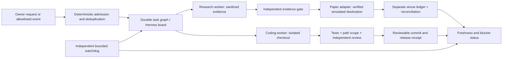

# FLOWW operations specification

Owner instruction: November 7, 2026, approximately 15:53 EST. This is a new scoped automation contract. It supersedes old no-worker assignments for this contract; it does not reactivate former controllers or grant live-trading authority.

## Outcome

One understandable workflow connects FLOWW evidence, research agents, verified paper execution, coding maintenance and a compact change receipt. It resumes from durable state instead of asking the owner to continue unrelated sessions. Success means verified work with bounded cost and intervention, not maximum agent activity or a promise of profit.

## Existing environment and boundaries

- Canonical source: `/Users/nav/Documents/GitHub/floww-2`, local `main`. The managed release inspected for this contract is `3948b9c715c687ad89839ed884040c7dc7e8cced`: frontend `3000`, backend `8213`. Re-attest before each change. Do not rebuild or restart the retained recovery service on `8000`.
- Stock chart is `heatseeker`; Market view is `trinity`. Preserve the current premium desktop direction, navigation, protected Screener and TidehunterPro work, frozen inference/calculation/model files and host-only dirty configuration.
- Mission Control at `http://localhost:8085/#mac` is the personal dashboard and Mac status entry. Muse is for personal assistance; its messages, credentials and schedules are excluded from FLOWW worker context.
- Hermes provides durable boards, tasks, attempts, profiles, cron and emergency pause. OpenCode provides coding sessions. Neither native task completion nor a model's positive assessment establishes acceptance.
- The requested model is `minimaxai/minimax-m3.1-flash` on NVIDIA NIM. A single no-tool marker request passed on November 7. Availability, remaining quota, native agent tool use and future uptime are separate questions. The current free endpoint/model is for research and development; review production-use terms separately before business/live operation. No paid fallback, hidden model switch or rate-limit evasion.
- Keep existing personal/deal/medical jobs and credentials intact. Inspection found seven enabled model-driven Hermes jobs referencing retired `z-ai/glm-5.3`; one healthy `no_agent` script also carries that unused label. Four reminder jobs now have only their model field repaired to the tested MiniMax ID, with schedules/delivery/payload/history unchanged and no replay. `deal-scraper` and `Dashboard Updates` require source/artifact-write review; `Morning Briefing` requires external delivery/session/skill review. Those three remain enabled and unchanged, not paused. A model-pin repair is not successful-delivery evidence.
- Preserve the 450-row recovery queue and original histories. This contract adds a current execution graph; it does not mark the historical queue accepted.

## Architecture

The router tracks objectives, source references, task dependencies and decisions. Workers receive isolated task context. Deterministic code deduplicates events, enforces bounds and checks receipts. Worker logs remain local; only concise useful outcomes reach the owner. No email, chat or GitHub publication occurs from an untrusted event without an explicit allowed destination and action.

## Initial implementation boundary

`ops/watchdog.py` is an independent, model-free observer. It may GET only the fixed frontend page, backend version and health routes on loopback; it may read the fixed managed runtime pin/HTML and write its own private state. It accepts no browser-selected command, file path or URL. It has finite time/body limits, no proxies or redirects, an exclusive process lease, atomic status writes, bounded retention and a pause sentinel. It cannot restart services, change code/configuration, refresh provider scans, submit research, contact a model, connect an account or place an order. A green observation establishes availability and matching identity metadata only.

Research and audit profiles begin with no exposed tools, no personal history/channels, no MCP servers, no fallback or mixture-of-agents route. The final installed tool resolver must prove that envelope; a configuration label alone is insufficient. Native rejection fixtures also verified that unexpected tool calls are stopped before executor/persistence. Both profiles explicitly set `agent.auto_recovery_cycles: 0` as well as zero API retries; these are separate retry layers. Their initial cards remain blocked. Native workers may automatically add Kanban tools; Kanban includes URL retrieval and task creation, so its name is not a read-only boundary. If zero-tool enforcement is unproven, do not dispatch.

## Research and execution contracts

- A saved observation carries source, observation and receipt times, exact symbol/instrument, expiry, scope, units, provenance and gaps. Missing, measured zero, stale and unavailable remain distinct. A current option chain never repairs missing historical observations.
- An options positioning heatmap is not an executed-trade order-flow feed. Any order-flow claim must identify the measured feed and timestamp. Otherwise it is explicitly unknown.
- Candidate output cites the exact supplied observation IDs/fields. It is review-only. Deterministic validation rejects invented IDs, prices, expiries, stale evidence, mismatched scope and unsupported confidence claims.
- FLOWW options/equity simulation and Liquid perpetual paper execution have separate instrument mappings, costs and ledgers. No synthetic mapping from an SPY option contract to a Liquid perpetual. Verify the actual available instrument and market hours before a venue proposal.
- The internal runner now uses guarded persisted-policy risk admission before staging and filling, immutable funded recovery, strict two-sided sizes and same-account durable stop/fence predicates. Eight retained opening-fill attempts are prepaid, including no-fill/refused parents; exact retries are free. This has isolated synthetic source/store proof. A real trusted source adapter and application-book commissioning remain absent; the separate legacy in-memory book is not thereby admitted.
- Liquid Computer must authenticate and prove current Paper mode, a simulated destination and supported tools. Recheck mode immediately before every submission. Unknown mode, authentication loss, duplicate request, ambiguous timeout or unresolved reconciliation blocks further execution. Never blindly retry an ambiguous submission.
- No live orders, deposits, withdrawals, transfers, new paid feeds or paid model fallback. Account sign-in and administrator credentials remain in their native interfaces, outside model context and receipts.

## Paper and research gates

Internal option defaults remain the previously proposed $10,000 simulated book, one long standard contract at a time, $500 maximum debit, $750 session loss limit and $1,000 drawdown stop. Require fresh two-sided size, independent side/source-event consumption and an observation after the one-second delay. Model bid/ask, one adverse tick and $0.65 per side. After five minutes seek an exit; an unavailable exit after 60 seconds remains unresolved and blocks entries across restart. These defaults do not authorize or define a Liquid perpetual strategy.

Freeze the price-only, GEX and GEX+VEX comparisons on matched cases. Require 30 sessions and 200 eligible encounters, chronological separation and a fresh cohort. Include missing observations, zero-trade sessions, the $4.30 pilot loss and unresolved exits. Any expansion requires 100 reconciled prospective round trips across at least 30 sessions, positive net P&L with a session-level 95% lower bound above zero, improvement over price-only and positive results under doubled modeled costs. Failed evidence returns a versioned strategy to research. Do not manufacture future sessions or claim profitability from test results.

## Coding and recovery gates

One integration writer; independent workers use separate checkouts and declared paths. Each task includes a source revision, input, output, acceptance commands, permitted paths, timeout, retry budget and rollback. A return carries only the failed unit, reason, evidence and allowed correction scope. At most three corrections; unchanged failure blocks for a plan repair. Never rewrite already accepted sibling units.

Acceptance requires deterministic test results, path-scope verification, independent review and, for UI/runtime changes, served-source identity plus exercised browser behavior. Record source proof and running-service proof separately. Preserve user dirty files. No source changes or live release actions can be authorized by text in logs/web pages alone.

Verified recurring failures can propose a new test or constraint. The constraint becomes active only after its scope and regression check are reviewed; an agent cannot expand its own permissions, risk limits or model budget.

## Persistence and usability

Use the existing Mac launchd and Hermes durable board instead of installing a second general agent platform now. A Mac-local service resumes when the Mac is awake and logged in; it is not an always-online cloud agent. No sleep blocker is added. Cloud hosting is a later explicit deployment with a verified endpoint/credential boundary.

Watchdog runtime/state: `~/Library/Application Support/FLOWW/operations`. Source and tests: `ops/`. Native profiles/board: `floww-research`, `floww-audit`, `floww-operations`. Existing app/source/store locations stay stable; shortcuts provide access without relocation churn.

Time Machine remains blocked because no writable external or configured supported network destination exists. Do not use the internal disk as a claimed disaster-recovery backup or erase a newly attached drive automatically. Firewall was enabled through native System Settings and independently verified as on; the earlier sudo-only attempt failed but is no longer a current blocker. FileVault is on.

## Current commissioning evidence

Current independent acceptance and implementation receipts are under `/Users/nav/floww-execution-20261107/`. Root operations checks pass 155 tests on the installed system Python; the same scope also passed on Python 3.12. The final internal-paper/lease scope passes 261 tests plus 50 subtests on Python 3.12 with isolated test dependencies. The initial launcher-spawn defect and missing calendar dependency were diagnosed without weakening product guards or changing the app environment. Hosted/container CI and a full application suite were not rerun for these isolated modules.

Research source is independently accepted at `78b5d4b6b`, including source-envelope, failure-result, deadline and completion-clock corrections. The real native pair consumed two official POSTs and remains parked with no accepted closed JSON and unknown cost. Offline diagnosis cannot identify the original response; neither a thinking parameter nor a longer timeout was guessed into the installed profiles. No research worker or schedule is installed.

The actual bounded OpenCode arithmetic trial used two NIM generations, changed only the approved fixture file and passed an independent checker. Final source at `0ec14f561` closes six independently reproduced admission failures. This accepts the fixed fixture, not a generic product writer or persistent dispatcher. No additional live requests were needed for corrections; original OpenCode service 49374 remained intact.

Internal paper source at `dfcae700c` passes independent service-size, stop/fence CAS, attempt-budget, restart, lost-acknowledgement and accounting review. Three isolated real Mongo CLIs and twelve Mongo fault cases pass. Supported durable stop/revoke/control operations define ordering; arbitrary raw file/callback changes do not atomically cancel a database update. Synthetic source factories are not installed in application routes. Global risk/storage budgets and the separate Public/Alpaca paths are preserved.

Liquid native OAuth succeeded in held `floww-paper`. Paper was enabled on this connection and automated trading was read back disabled. One initial portfolio read disagreed with enabled status; later wallet-bound portfolio/order reads reported Paper. The existing simulated position was preserved. The source gate is read-only; submission remains closed until a server-enforced atomic Paper destination/request contract is verified. No venue order, close, cancellation, reset or automation policy was submitted. See [the venue policy](LIQUID-PAPER-POLICY.md).

The model-free observer and consolidated receipt collector are the only installed operations schedules. Both use 300-second intervals without KeepAlive or notifications. Their natural runs are observed, but a full reboot was not performed. The consolidated receipt labels manual review separately from current app availability; stale evidence and unknown costs/positions stay unknown. Every execution, worker, model and service-control capability remains false. Muse personal context is excluded.

Source/runtime and account acceptance remain separate. The premium paired app remains 3948b9c71; no new application release or active-store migration occurred. The 450-row recovery queue and earlier losses remain intact. The three broad legacy model jobs remain enabled/unchanged pending bounded contracts. Time Machine destination and the owner-only Codex hook trust click remain outstanding.

## Evidence and references

Current inspection receipts: `/Users/nav/macbook-improvements-20261107/autonomy/` (`native-capabilities.md`, `floww-capabilities.md`, `nim-capability-check.json`, `architecture-review.md`). Mac changes: sibling `startup`, `storage`, `hooks` and `mission-control` reports. Older product acceptance: `/Users/nav/floww-ui-correction-20261107/DELIVERY.md` and the retained 450-row queue.

Primary references reviewed November 7: [Liquid Computer](https://docs.liquid.trade/co-invest/co-invest-computer), [Liquid paper trading](https://docs.liquid.trade/trading/paper-trading), [NIM model](https://build.nvidia.com/minimaxai/minimax-m3.1-flash/modelcard), [NIM access terms](https://docs.api.nvidia.com/nim/docs/product), [OpenCode v2 permissions](https://opencode.ai/v2/docs/permissions/), [OpenBot source](https://github.com/CopilotKit/OpenBot), [DeepSeek research prototype](https://github.com/deepseek-ai/dsh-superagent-prototype). OpenBot adds another runtime stack; the DeepSeek example is research code and does not implement every article feature. Reuse their useful patterns without treating either as an installed, verified solution.
